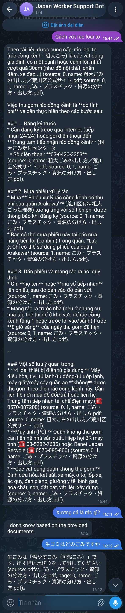
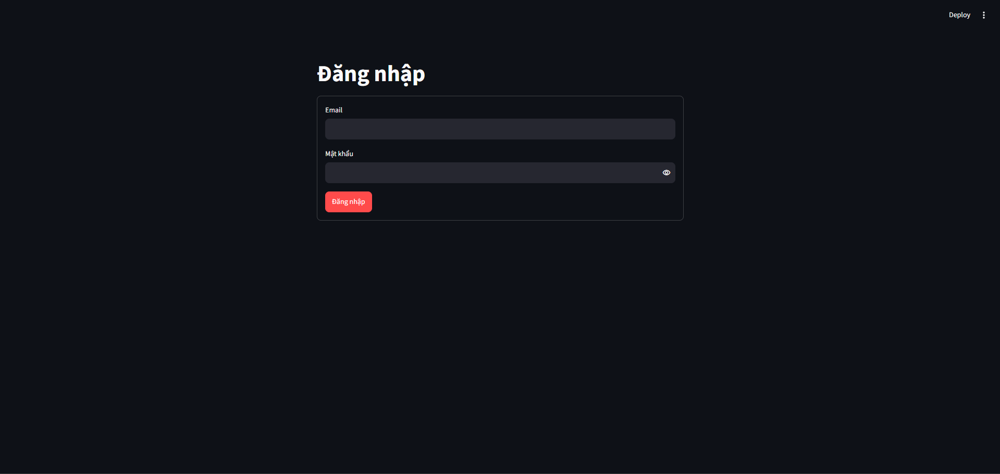
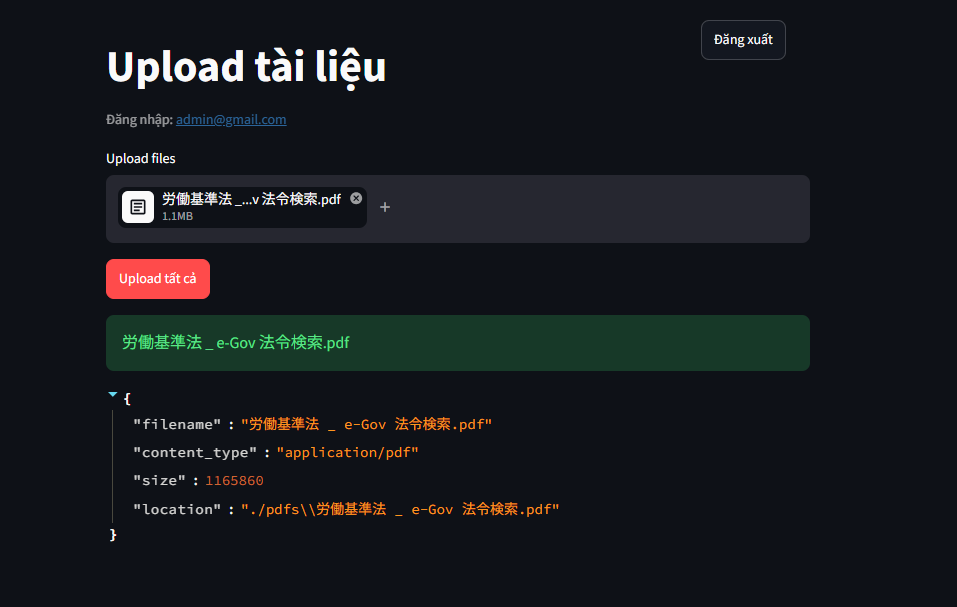

# Japan Worker Support RAG

A Retrieval-Augmented Generation (RAG) application for Japanese worker support, built to help users search, query, and retrieve answers from uploaded documents quickly and accurately.

The system supports PDF ingestion, semantic search, language model-based answer generation, and a lightweight admin dashboard. It is designed for internal knowledge bases, document support, and quick access to operational information.

## Overview

This project combines:

- FastAPI for backend APIs
- Streamlit for the admin UI
- LangChain and vector search for retrieval
- MongoDB Atlas for vector storage
- SQLite for user authentication data
- Telegram bot integration for conversational access

The app allows an administrator to upload documents, process them into searchable chunks, and then answer questions using the uploaded knowledge base.

## Features

- PDF upload and storage
- Automatic document extraction and chunking
- Vector embedding and retrieval using MongoDB vector search
- Question answering based on the uploaded content
- Admin login flow for document management
- Telegram bot interface for quick Q&A
- Modular service and controller architecture

## Screenshots

<div align="center">
  
</div>

<div align="center">
  
  
</div>

## Architecture

The project is organized around a retrieval pipeline:

1. Documents are uploaded through the Streamlit admin interface or API.
2. Files are saved to the configured upload folder.
3. The extractor reads and processes document content.
4. Text is split into chunks and embedded.
5. Chunks are stored in MongoDB Atlas for vector retrieval.
6. A language model answers questions using the retrieved context.

## Tech Stack

- Python
- FastAPI
- Streamlit
- LangChain
- LangGraph
- MongoDB Atlas
- SQLite
- Telegram Bot API
- Sentence Transformers / Hugging Face embeddings

## Project Structure

```text
.
├── common/
├── configs/
├── controllers/
├── images/
├── interface/
├── models/
├── notebooks/
├── services/
├── tests/
├── .env.template
├── bot.py
├── main.py
├── README.md
├── requirements.txt
├── ui.py
└── ...
```

## Environment Setup

Create a `.env` file based on `.env.template` and fill in the required values.

```env
HUNGGING_FACE_TOKEN=
MONGODB_CONNECT_URL=
MODEL_URL=
VECTOR_DB_NAME=
LM_MODEL_ID=
UPLOAD_FOLDER=
GOOGLE_API_KEY=
TELEGRAM_API=
RAG_APP_URL=
BCRYPT_SALT=
SQLITE_PATH=
ADMIN_EMAIL=
ADMIN_PASSWORD=
```

## Installation

```bash
pip install -r requirements.txt
```

## Run the application

Start the API service:

```bash
uvicorn main:app --reload
```

Run the admin UI:

```bash
streamlit run ui.py
```

Run the Telegram bot:

```bash
python bot.py
```

## Usage

1. Set up the environment variables.
2. Start the FastAPI backend.
3. Open the Streamlit interface.
4. Log in with the admin account.
5. Upload PDF files.
6. Trigger ingestion to build the knowledge store.
7. Ask questions through the API, UI, or Telegram bot.

## Notes

- The application expects user credentials for the admin account.
- Uploaded files are processed into vector documents for retrieval.
- The project is best suited for internal knowledge management and document-oriented support scenarios.

## License

This project is available for internal and research use under the repository's existing license terms.

