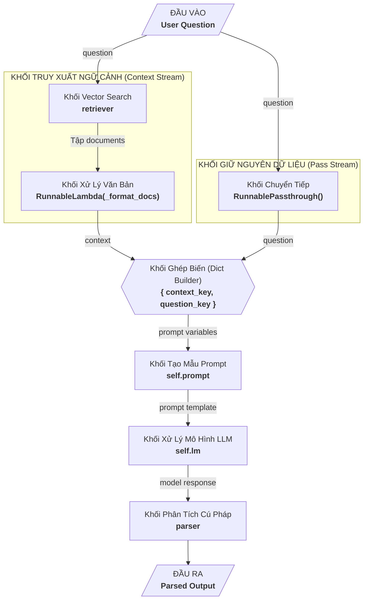

# 2026年10月15日
## Bug
## Bug 01: Out of context do retriever
+ 内容
```bash
langchain_openai.chat_models.base.OpenAIInvalidRequestError: 
Error code: 400 - {'error': {'message': 
"This model's maximum context length is 8192 tokens. 
However, you requested 0 output tokens and your prompt 
contains at least 8193 input tokens, for a total of at 
least 8193 tokens. Please reduce the length of the input 
prompt or the number of requested output tokens. 
(parameter=input_tokens, value=8193)", 
'type': 'BadRequestError', 'param': 'input_tokens', 'code': 400}}
```
+ Vấn đề
  + Dù câu hỏi rất ngắn: "what is llm?" nhưng vẫn quăng lỗi out of context
  + Khả năng do context mà retriver chèn vào (Nhờ AI fix lỗi)
+ Nguyên nhân
```python
{self._context_key: retriever, self._question_key: RunnablePassthrough()}
```
Khi chain chạy, retriever nhận `câu hỏi` và trả về `list[Document]` chứ không phải
chuỗi. Kết quả ví dụ
```bash
[Document(id='...', 
metadata={
  'source': 'a.pdf', 
  'page': 3, 
  'embedding': [0.0123, -0.0456, 0.0789, ...1024 số...], 
  '_id': '...'}, 
page_content='nội dung...'), Document(...), ...]
```
Toàn bộ kết quả này sẽ chạy vào context của prompt dẫn đến tràn context
+ Giải quyết
  + Tạo 1 custom format doc function chỉ lấy `source`, `page`, `page_content`
để truyền vào context
  + Sửa hàm `invoke` trong `run_chain` như code dưới

```python
def _format_docs(docs):
    parts = []
    for d in docs:
        src = d.metadata.get("source", "unknown")
        page = d.metadata.get("page", "?")
        parts.append(f"[source: {src}, page: {page}]\n{d.page_content}")
    return "\n\n---\n\n".join(parts)
```
```python
rag_chain = (
            ({self._context_key: retriever | 
                                 RunnableLambda(_format_docs) , 
              self._question_key: RunnablePassthrough()})
            | self.prompt
            | self.lm
            | parser
        )
```
Flow

## Note
### Note 01: LRU Cache
+ Decorator `@lru_cache` dùng để lưu kết quả của hàm
+ Khi bộ đệm đầy thì mục được sử dụng xa nhất sẽ bị loại bỏ
+ Giống thay trang trong hệ điều hành
### Note 02: Dependencies injection trong FastAPI
+ Tạo 1 file `dependencies.py` và khai báo các dependencies trong đó. Ví dụ như ở dưới
+ Khi gọi trong controller, dùng `Depends()` của FastAPI
+ Do là dependencies injection nên best practice là truyền datatype là 
interface vào parameter và dùng `Depends()` để inject implementation. Như ở dưới là truyền `lm_service` có
kiểu dữ liệu `LanguageModel` và triển khai nó bằng `Depends()`

```python
# dependencies.py
from functools import lru_cache

from services.embed_serivce import EmbedService
from services.store_service import MongoAtalasStoreService
from services.qwen_service import QwenService


@lru_cache
def get_vector_store() -> MongoAtalasStoreService:
    emb_model = EmbedService().embeddings
    return MongoAtalasStoreService(emb_model)


@lru_cache
def get_lm_service() -> QwenService:
    return QwenService()


def get_retriever():
    return get_vector_store().retriever
```

```python
# Controller
@router.post("/ask", response_model=QuestionResponse)
def ask(question: QuestionRequest, lm_service: LanguageModel = Depends(get_lm_service),
        retriever: VectorStoreRetriever = Depends(get_retriever)):
    response = lm_service.run_chain(question.question, retriever)
    return QuestionResponse(response=response)
```

### Note 03: RunnableLambda
+ Package: `langchain_core.runnables`
+ `Runnable`: là giao diện chuẩn (interface) cho mọi thành phần trong chuỗi (như Prompt, LLM, Retriever, Output Parser) để chúng có thể kết nối với nhau qua toán tử `|` (LCEL - LangChain Expression Language).
+ Tác dụng: biến 1 hàm python thông thường thành 1 `Runnable`